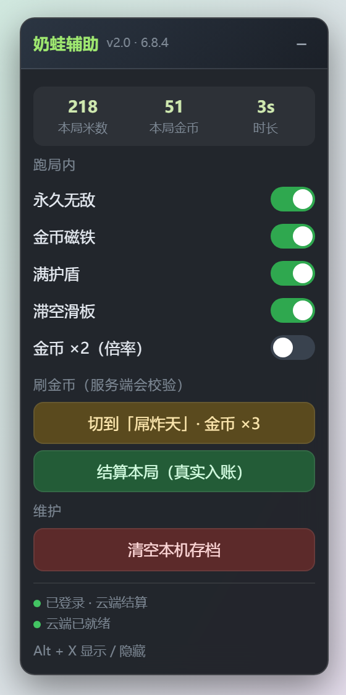

# 奶蛙快跑 · 辅助面板

> 一个 Tampermonkey 用户脚本，为 [奶蛙快跑](https://xn--yus23mh00b62f.vip/)（three.js 无限跑酷）加上**纯前端**的跑局辅助：永久无敌、金币磁铁、满护盾、滞空滑板、金币双倍、一键切「屌炸天」难度。



**当前适配版本：v6.8.4（2026-10）· 脚本 v2.0.0**

---

## 这次更新了什么

作者把站点整体重做了，v1.0.0 的大部分功能已经失效。差异如下：

| 项目 | v1.0.0 时（旧站） | v6.8.4（现在） |
| --- | --- | --- |
| 域名 | `naiwa-kuaipao.pages.dev` | `奶蛙快跑.vip` / `xn--yus23mh00b62f.vip`（pages.dev 只剩跳板页） |
| 入口 | 直接进游戏 | **强制登录**，未登录访问 `/game?mode=solo` 会被 302 打回 `/login` |
| 引擎加载 | 独立请求 `engine.js` | 内联分发，局部变量混淆（但全局接口名保留） |
| 金币 / 皮肤 | 纯本地 `localStorage`，改了就生效 | **服务端权威**：`runs/start` → `runs/finish` → `wardrobe` 全套校验 |
| 服装数量 | 73 套 | 121 套（20 史诗 + 100 精英 + 经典） |
| 难度 | easy / normal / hard | 新增 `diao`（屌炸天）：金币 ×3，每 3 万米再 +2000 |

### 现在还能做什么

| 功能 | 状态 | 说明 |
| --- | --- | --- |
| 永久无敌 | ✅ 有效 | 改写 `invincible = Infinity`，`Math.max(0, Infinity - dt) === Infinity` 永不衰减 |
| 金币磁铁 | ✅ 有效 | v6.8.4 吸附半径变大（dx<9、\|Δy\|<6），吸得更狠 |
| 满护盾 | ✅ 有效 | 保持 `CONFIG.maxShields` = 3 |
| 滞空滑板 | ✅ 新增 | `hoverboard > 0` 时 `hit()` 直接短路，等于第二个无敌 |
| 金币 ×2 | ✅ 新增 | `multiplierTimer` 续杯，金币翻倍 |
| 一键「屌炸天」 | ✅ 新增 | 金币 ×3 + 里程碑奖励 |
| 真实结算入账 | ✅ 有效 | 走游戏自己的 `home() → bankRun() → POST /api/v1/runs/{id}/finish` |
| 直接改存档刷金币 | ❌ 失效 | 会被 `runs/finish` 拒绝（422），随后 `wardrobe pull` 把本地值抹回服务端 |
| 解锁全部服装 | ❌ 失效 | `canWearOwned()` 只认服务端下发的 `wardrobeOwned` 集合 |

### 关键实测数据

```
diao 难度 + 无敌 + 磁铁，跑 37.4 秒
  → 2828 米 / 3702 金币
  → POST /api/v1/runs/{id}/finish  →  200 {"ok": true, "progressSynced": true}
  → 金币正常入账，可用来买皮肤

直接 game.coins += 100000 再结算
  → POST /api/v1/runs/{id}/finish  →  422 {"error": "本局成绩超出服务器合理范围，未云同步"}
  → POST /api/v1/wardrobe（pull）  →  本地 coins 被打回 0
```

所以正确姿势是：**让游戏自己跑、自己结算**，而不是伪造钱包。无敌 + 磁铁 + 屌炸天跑够时间，金币就是合法赚到的，能直接拿去商城买皮肤（服务端原子扣币、授予）。

---

## 安装

1. 给浏览器安装 [Tampermonkey](https://www.tampermonkey.net/)（油猴）扩展。
2. 打开下面这个链接，Tampermonkey 会自动弹出安装页：

   ```
   https://raw.githubusercontent.com/iu6888/naiwakuaipao-helper/main/naiwa-helper.user.js
   ```

   或者手动：Tampermonkey 面板 → **添加新脚本** → 清空编辑器模板 → 整段粘贴 [`naiwa-helper.user.js`](naiwa-helper.user.js) 的内容 → `Ctrl + S` 保存。

3. 打开 <https://xn--yus23mh00b62f.vip/> 登录账号，进「单人开跑」或「联机对战」。
4. 进入 `/game` 后，右上角会出现面板。`Alt + X` 显示 / 隐藏。

> 脚本头部已经写好 `@downloadURL` / `@updateURL`，装过一次之后 Tampermonkey 会自动检查更新。

## 使用

1. 登录后进入游戏（**必须先进 `/game`**，停在上面的登录页是没有面板的）。
2. 三个开关默认已开：永久无敌、金币磁铁、满护盾。
3. 点「切到「屌炸天」· 金币 ×3」，再点游戏里的「开始奔跑」。
4. 挂了十分钟，想收菜时点面板上的「结算本局（真实入账）」——它调用游戏自己的 `home()`，走服务端结算。
5. 回主界面打开商城，用刚赚的金币买皮肤。服务端确认价格、原子扣币、授予皮肤。

面板顶部的三个数字是**本局实时**的米数 / 金币 / 时长，不用低头看游戏 HUD。

---

## 工作原理

### 1. 无敌：写 `Infinity`，让衰减函数自己失效

游戏每帧都会跑这段：

```js
for (const k of ["slide", "hurt", "invincible", "magnet", "hoverboard", "multiplierTimer", "comboTimer"])
  this[k] = Math.max(0, this[k] - dt);
```

`Math.max(0, Infinity - dt) === Infinity`。所以只要写进 `Infinity`，这个计时器永远回不到 0。

配合两处控制：

```js
// step() 碰撞判定：invincible <= 0 才算撞上
if (!safe && this.invincible <= 0) { o.hit = true; this.hit(); if (this.status === "over") break; }

// hit() 受伤判定：invincible > 0 或 hoverboard > 0 直接短路
hit() {
  if (this.invincible > 0 || this.hoverboard > 0) return;
  if (this.shield > 0) { this.shield--; this.invincible = 1.2; return; }
  if (this.hurt > 0) { this.status = "over"; }
  else { this.hurt = CONFIG.recovery; /* 7s */ this.invincible = CONFIG.invulnerability; }
}
```

脚本做三件事：

1. **Hook `Game.prototype.reset`** —— 每次开局 `reset()` 会把 `invincible / magnet / shield` 抹零，所以在 `reset()` 之后重新写入。
2. **Hook `Game.prototype.hit`** —— 兜底，漏过来的命中直接 return，不推进 `hurt`。
3. **250ms 续杯** —— 磁铁 / 滑板 / 倍率都是有秒数的道具，持续补回游戏自己的时长值。

> 磁铁为什么不用 `Infinity`？HUD 会渲染 `Math.ceil(magnet) + "s"`，`Infinity` 会显示成 `Infinitys`。吸附只看 `magnet > 0`，所以续杯成 12 秒就够，界面还正常。

### 2. 注入时机：两阶段等待

内联脚本的执行顺序是 `engine.js`（定义 `RunnerCore`）→ `game.js`（`new Game()`）→ `assets/characters.js`（`CHARACTER_ASSETS`）。所以：

- **阶段一**：轮询到 `window.RunnerCore.Game` 一出现，立刻 patch `Game.prototype` —— 这样 `new Game()` 的第一次 `reset()` 就已经被接管了。
- **阶段二**：等 `window.gameDebug` 挂上 `window`，才拿得到 `game` 实例、才能建面板。

`document-start` 起跑，每 120ms 探一次，最长等 120 秒。

### 3. 为什么金币改不动了

旧站是纯本地存档，`localStorage["sunny-run-v4-profile"]` 明文 JSON，`WardrobeStore` 只做本地白名单校验，改了刷新生效。

现在：

```js
// 开局先申请服务端票据
POST /api/v1/runs/start   { seed, map, difficulty, requestId }
  → { runId, ticket, expiresAt }

// 结算带上票据，服务端按时间 / 速度 / 距离核对上限
POST /api/v1/runs/{runId}/finish  { ticket, distance, coins, jumps, slides, roofDistance, time }
  → 200 { ok: true, progressSynced: true }   合法
  → 422 { error: "本局成绩超出服务器合理范围，未云同步" }   造假

// 每次结算后回拉衣橱，用服务端数据覆盖本地
GET /api/v1/wardrobe
  → next.coins = w.coins;  next.ownedOutfits = w.ownedOutfits; ...
```

而 `canWearOwned()` 额外检查 `wardrobeOwned`（服务端授权集合）：

```js
function canWearOwned(id) {
  const t = gameSessionToken();
  return id === "classic" || !!t && t === wardrobeOwnerToken && wardrobeOwned.has(id);
}
```

本地 `ownedOutfits` 里写了也不算数，穿不上。

---

## 兼容性与已知问题

- `@match` 同时匹配 `https://xn--yus23mh00b62f.vip/*` 和旧的 `https://naiwa-kuaipao.pages.dev/*`。
- 只对**已登录并进入 `/game`** 的页面生效。停在 `/login` 时面板不会出现，控制台会提示超时。
- 依赖 `window.RunnerCore`、`window.gameDebug`、`window.NaiwaRunProgress` 和内部字段名（`invincible` / `magnet` / `shield` / `hoverboard` / `multiplierTimer` / `hurt` / `coins`）。作者自己的发布说明写着「保留共享接口、函数及属性命名」，但没有承诺永远不变；真大改了要跟着调。
- 面板用 Shadow DOM + `:host { all: initial }` 做样式隔离，不会和游戏 CSS 互相污染。
- 在 Chromium 实测通过，Chrome / Edge 正常可用。Safari 未验证。
- 联机对局请慎用。服务端有战绩校验和 `devMode` 判定，异常可能不计战绩或按断线处理。

## 卸载 / 还原

- 删除 Tampermonkey 里的本脚本即可。
- 想清掉本机存档：点面板上的「清空本机存档」，或手动

  ```js
  localStorage.removeItem("sunny-run-v4-profile");
  location.reload();
  ```

  清完后下次进游戏，`GET /api/v1/wardrobe` 会重新把服务端进度拉回来。

## 声明

- 本脚本基本为 AI 生成，如有侵权请告知删除。
- 金币和皮肤是作者的变现内容。作者是个人开发者（游戏内「加入我们」有 QQ 邮箱和抖音号）。如果玩得开心，建议支持一下。
- 只修改你自己浏览器里的客户端状态，不涉及服务端漏洞，不影响其他玩家。使用产生的任何后果由使用者自行承担。

## License

[MIT](LICENSE)
